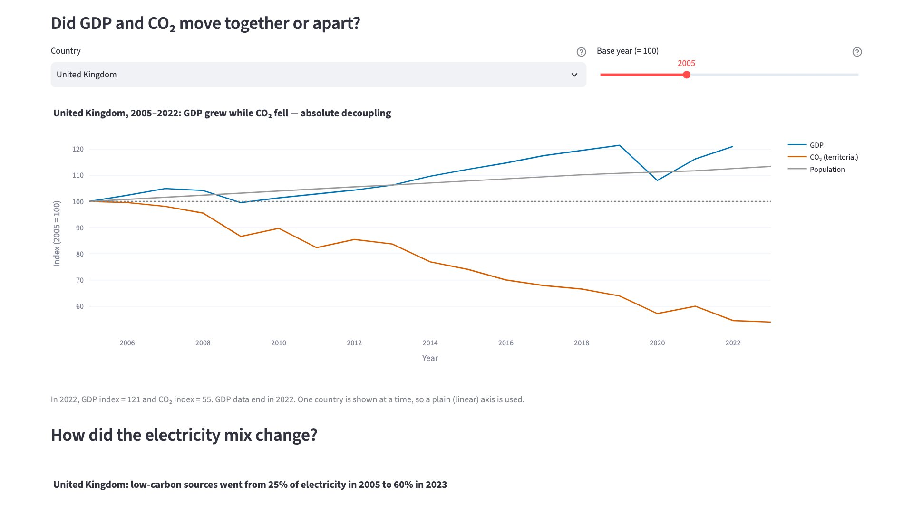
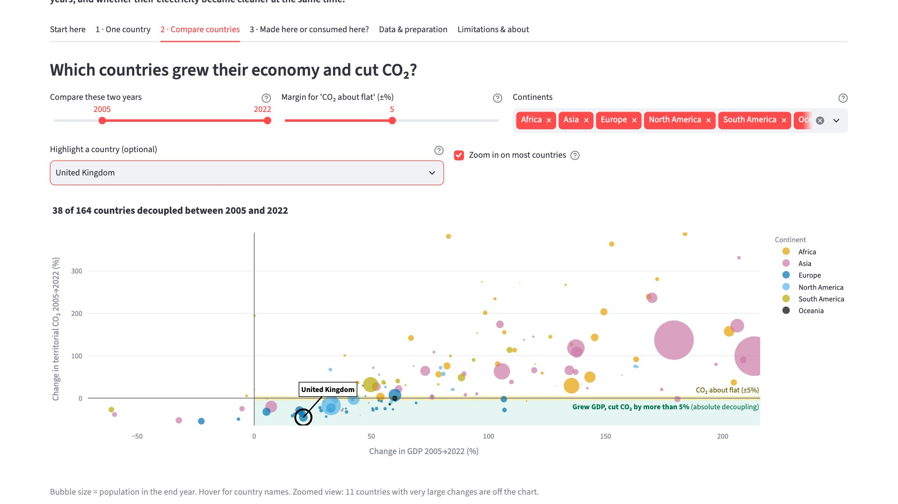
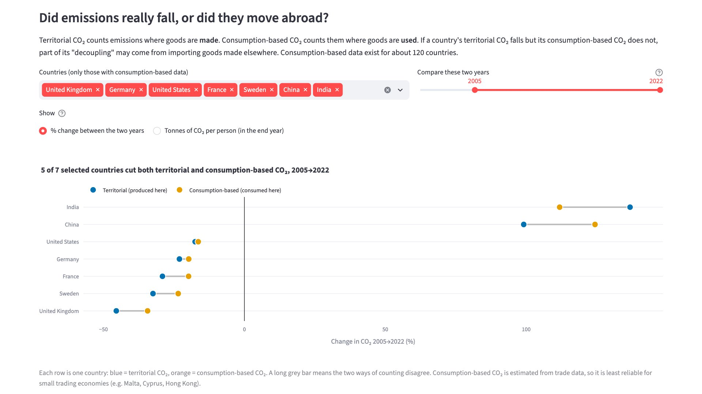

# Growing Economies, Falling Emissions? — Energy Transition Explorer

An interactive Streamlit app that shows **which countries grew their economy while clearly cutting CO₂ emissions,
over which years, and whether their electricity became cleaner at the same time.**

- **Repository:** [github.com/mehady007/CMSE830-project](https://github.com/mehady007/CMSE830-project)

Mehady Hassan · CMSE 830 Midterm Project · Michigan State University · Fall 2026

---

## The question and who it is for

People often hear two opposite claims: *"rich countries are cutting emissions while still growing"* and
*"economic growth always needs more fossil fuel."* This app lets a **non-expert user** (a student, a journalist,
or anyone curious about climate policy) check these claims with real data.

**Central question:** *Which countries have grown their economies while clearly cutting territorial CO₂ emissions
(absolute decoupling: GDP up and CO₂ down by more than 5%), and what changed in their electricity mix?*

After using the app, a user can look up any country, see whether it decoupled between two years they choose,
compare it with other countries, and check whether the drop in emissions is real or only moved abroad.

| One country | Compare countries |
|---|---|
|  |  |



## Key findings (2005 → 2022)

Numbers refer to the data snapshot of 16 October 2026 (`docs/results.json`, written by the notebook).

- **38 of 164 countries (23%) decoupled**: GDP went up and territorial CO₂ fell by more than 5%. Another 11
  grew while their CO₂ stayed about flat (within ±5%). **30 of the 38 decouplers are in Europe**; Africa has 1
  decoupler out of 50 countries with data.
- **It is a small group when counted by people.** Decouplers hold about 1 in 8 of the people (12.5%) and a quarter
  of the CO₂ (24.7%) of the 164 countries, because the most populous countries (China, India) are still in coupled
  growth.
- **Decouplers made their electricity cleaner, clearly so in Europe.** Their low-carbon share of electricity rose by
  a median of **+13 percentage points**, against **+1.3 points** for coupled-growth countries (Mann–Whitney,
  p < 0.001). Inside Europe the gap is clear (+14 vs 0, p = 0.005); outside Europe there are only 8 decouplers and
  the difference could be chance (+5 vs +1, p = 0.40). Among countries that used coal, decouplers cut coal's share by
  11 points while coupled-growth countries added 4. This is an association, not proof of cause.
- **Most decoupling is not just "outsourcing".** Of the 33 decouplers that also have consumption-based data,
  **26 also cut their consumption-based CO₂** (which counts emissions in imported goods).
- **The overall picture is robust; single countries are not always.** Across four year pairs (2000→2022,
  2005→2022, 2010→2019, 2010→2022) there are 35–40 decouplers and 119 of 164 countries (73%) keep the same label.
  With no margin there are 45 decouplers, with ±10% there are 32; Europe is the large majority every time.

## Data sources

| Dataset | Provider (original sources) | URL | Licence | Main variables and units | Years used |
|---|---|---|---|---|---|
| CO₂ and Greenhouse Gas Emissions (`data/owid-co2-data.csv`, 50,411 rows × 79 cols) | Our World in Data (Global Carbon Project, Maddison Project Database, UN World Population Prospects) | https://github.com/owid/co2-data | CC BY 4.0 | CO₂ (million tonnes; tonnes per person), consumption-based CO₂, GDP (international $, 2011 prices), population | 1990–2023 (GDP ends 2022) |
| Energy (`data/owid-energy-data.csv`, 23,377 rows × 130 cols) | Our World in Data (Energy Institute Statistical Review, Ember) | https://github.com/owid/energy-data | CC BY 4.0 | Share of electricity generation by source (%) | 1990–2023 (comparisons from 2000) |
| Continents (`data/owid-continents.csv`) | Our World in Data | https://ourworldindata.org/grapher/continents-according-to-our-world-in-data | CC BY 4.0 | Continent of each country | — |

**Unit of observation:** one country in one year. **Join:** the CO₂ and energy files are joined on the
3-letter ISO country code and year (`iso_code`, `year`); the continent file is added by ISO code.
The CSVs are a snapshot downloaded in October 2026 and are stored in `data/` (largest file 14 MB, well under
GitHub's 100 MB limit), so the app runs on Streamlit Cloud without any download step.

## Data preparation decisions

The app (`app.py`) and the analysis notebook each contain the same three data-preparation functions
(`load_raw`, `build_panel`, `decoupling_table`), so each one runs on its own without any project module. The
notebook defines them in its Section 0 and only needs the three CSVs (it downloads them if they are missing).
Re-running the notebook reproduces `docs/results.json` exactly, and the app shows the same numbers.

1. **Aggregate rows removed.** 7,931 rows in the CO₂ file have no ISO code. They are 36 regions and groups
   ("World", "Africa", "High-income countries", "International shipping", …). Mixing them with countries would
   double-count emissions. (Kosovo also has no ISO code and is dropped for the same reason.)
2. **Data checks use 1990–2023; comparisons start in 2000.** Electricity-mix data are missing for 62.8% of
   country-years in 1990–1999 but only 8.2% from 2000 on, and the early 1990s include the collapse of the Soviet
   economy: a 1990 → 2022 comparison labels Russia, Belarus, Romania and Azerbaijan as "decouplers" only because their
   heavy industry collapsed first. So every year choice in the analysis and the app starts in 2000. GDP ends in 2022.
3. **Join coverage reported, not hidden.** 6,931 country-years match in both files. 481 rows are CO₂-only
   (12 micro-states such as Monaco and San Marino; kept, with empty electricity columns) and 476 rows are
   energy-only (14 territories such as Puerto Rico and Guam; dropped because they have no CO₂ data).
4. **GDP is not imputed.** GDP is missing for 24.8% of country-years (1990–2022), and the missingness is
   structural: it is missing for **76.9% of country-years in countries with under 1 million people**, against
   under 5% for larger countries, and it stops in 2022 for every country. A few larger countries affected by war or
   crisis also have no GDP (Sudan, Somalia, South Sudan, Papua New Guinea). A decoupling verdict built on invented GDP
   would be misleading, so these countries are labelled **"Insufficient data"** instead.
5. **Kuwait 1991 kept.** CO₂ per person has a median of 2.73 t but a maximum of 364.8 t (Kuwait, 1991, Gulf War
   oil-well fires). The value is real, so it is kept and annotated; charts of CO₂ per person use a log scale so
   it does not squash every other country.
6. **Consistency checks.** No duplicate country-years, no negative CO₂ or GDP, no electricity share outside
   0–100%, and country names agree on all joined rows.
7. **Decoupling label (feature).** For two chosen years: GDP up and CO₂ down by more than 5% → *Absolute
   decoupling*; GDP up and CO₂ within ±5% → *CO₂ about flat*; GDP up and CO₂ up by more than 5% → *Coupled growth*;
   GDP not up → *GDP fell*; GDP or CO₂ missing in either year → *Insufficient data*. The ±5% margin stops tiny
   changes (Australia: −0.3%) from counting as decoupling; such changes are within normal year-to-year swings and the
   uncertainty of CO₂ estimates. The notebook repeats the count with no margin and with ±10%, and the app has a slider.
8. **Main comparison 2005 → 2022.** 2005 is the year the Kyoto Protocol came into force and the EU emissions-trading
   system started; 2022 is the last year with GDP.

## App guide

| Tab | What it answers | Controls |
|---|---|---|
| **Start here** | What the app is for, how to use it, key terms, headline numbers | — |
| **1 · One country** | Did GDP and CO₂ move together or apart in this country? How did its electricity mix change? | Country, base year (index = 100) |
| **2 · Compare countries** | Which countries decoupled between two years? How does this differ by continent? Did decouplers make their electricity cleaner, and does that hold outside Europe? | Year range, ±% margin, continents, highlight a country, zoom, Europe vs. rest of the world |
| **3 · Made here or consumed here?** | Did emissions really fall, or did they move abroad through imports? (territorial vs. consumption-based CO₂, dumbbell chart) | Countries, year range, % change vs. tonnes per person |
| **Data & preparation** | Sources, the five preparation decisions, join result, missing data by year and by country size, the Kuwait 1991 outlier, the cleaned table | Show table |
| **Limitations & about** | What the app cannot tell you, author, AI-use note | — |

Every chart has a message-style title that updates with the selection. Colours are colour-blind-safe
(Okabe–Ito based) and identical in the app and the notebook. Decoupling groups use green (decoupled), yellow (CO₂
about flat), orange (coupled growth) and grey (GDP fell); continents use different colours, so a continent never
reads as a decoupling group.

## Repository structure

```
CMSE830-project/
├── app.py                     # Streamlit app (entry point; includes the data-preparation functions)
├── data/
│   ├── owid-co2-data.csv      # OWID CO₂ data (CC BY 4.0)
│   ├── owid-energy-data.csv   # OWID energy data (CC BY 4.0)
│   ├── owid-continents.csv    # OWID continent lookup (CC BY 4.0)
│   └── download_data.py       # re-downloads the three CSVs
├── notebooks/
│   └── energy_transition_analysis.ipynb   # self-contained IDA → EDA → results notebook (no project imports)
├── docs/
│   ├── app_*.jpg              # app screenshots used in this README
│   ├── figures/               # static figures saved by the notebook
│   └── results.json           # headline numbers written by the notebook
├── .streamlit/config.toml     # light theme
├── requirements.txt           # app + notebook dependencies
├── requirements-dev.txt       # adds Jupyter for re-running the notebook
├── AI_DISCLOSURE.md           # generative-AI use
├── LICENSE                    # MIT (code); data are CC BY 4.0 (OWID)
└── README.md
```

## Setup and run locally

Requires Python 3.11 or newer (tested with Python 3.13, streamlit 1.63, pandas 2.3, plotly 6.5).

```bash
git clone https://github.com/mehady007/CMSE830-project.git
cd CMSE830-project
python3 -m venv .venv
source .venv/bin/activate          # Windows: .venv\Scripts\activate
pip install -r requirements.txt
streamlit run app.py               # opens http://localhost:8501
```

**Re-run the analysis notebook** (needs Jupyter). The notebook imports no project code, so it also runs on its own
outside the repository: put it in any folder, and it uses a `data/` folder next to it (downloading the CSVs if needed)
and writes `docs/figures/` and `docs/results.json` there.

```bash
pip install -r requirements-dev.txt
jupyter notebook notebooks/energy_transition_analysis.ipynb
```

Running all cells recreates the figures in `docs/figures/` and the numbers in `docs/results.json`.

**Refresh the data** (optional; OWID updates its files, so numbers may change slightly from the
October 2026 snapshot):

```bash
python data/download_data.py
```

## Deploy on Streamlit Community Cloud

1. The repository is public on GitHub and already includes the data CSVs, so no download step is needed.
2. Go to https://share.streamlit.io, sign in with GitHub, and click **Create app**.
3. Pick the repository `mehady007/CMSE830-project` and branch `main`, set **Main file path** to `app.py`, and
   choose Python 3.12 under *Advanced settings*.
4. Click **Deploy**. Streamlit Cloud installs `requirements.txt` automatically.
5. Open the app in a private/incognito window to test it as a first-time user, then paste the link at the top
   of this README.

## Limitations

- **Mostly a European story.** 30 of the 38 decouplers are in Europe. The link with cleaner electricity is clear
  there, but outside Europe there are too few decouplers to tell whether it holds.
- **Counted by country, not by people.** Every country counts once; decouplers are 23% of countries but 12.5% of
  people.
- **Territorial CO₂ leaves out emissions in imported goods.** Some "decoupling" could come from moving
  manufacturing abroad. Tab 3 checks this with consumption-based CO₂, which exists for only about 120 countries and
  is an estimate from trade data (least reliable for small trading economies such as Malta, Cyprus and Hong Kong).
- **Association, not cause.** A cleaner electricity mix goes together with decoupling, but power-sector CO₂ is part of
  total CO₂, so the link is partly built in; economic structure, efficiency, prices and policy also matter. A few
  countries cut CO₂ during an economic crisis (e.g. Lebanon), which the label cannot tell apart from a transition.
- **The chosen years and margin matter.** About 1 in 4 countries changes group across different year pairs, and
  2020 (COVID) is an unusual year. The ±5% margin is a judgement call (45 decouplers with no margin, 32 with ±10%).
  The app warns about short periods and about 2020, and lets users change the margin.
- **Missing and uneven data.** Many small countries (especially in the Caribbean and Pacific) and a few larger
  countries affected by war or crisis have no GDP and are not classified. Europe has many more fully covered
  countries than Africa or Oceania (only 2 countries in Oceania have complete data), so continent comparisons are
  uneven and the results describe mid-size and large, better-documented countries.
- **Data years.** Comparisons start in 2000; GDP ends in 2022; CO₂ ends in 2023 in this app.

## AI use

Generative AI (Claude, Anthropic) was used for parts of the coding, documentation and text. The tools,
purposes, representative prompts, how outputs were checked, and my own contribution are described in
[AI_DISCLOSURE.md](AI_DISCLOSURE.md).

## Licence

Code: [MIT](LICENSE). Data: Our World in Data, [CC BY 4.0](https://creativecommons.org/licenses/by/4.0/) —
please credit Our World in Data and the original sources listed above.
